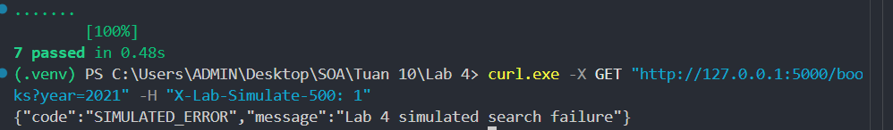
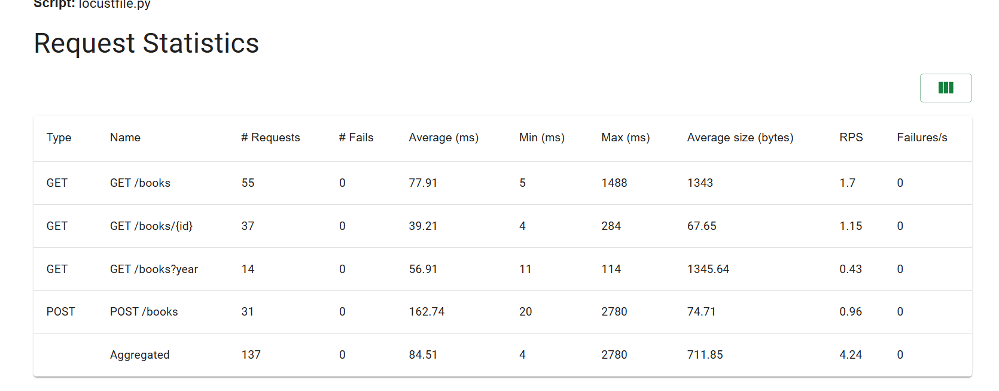
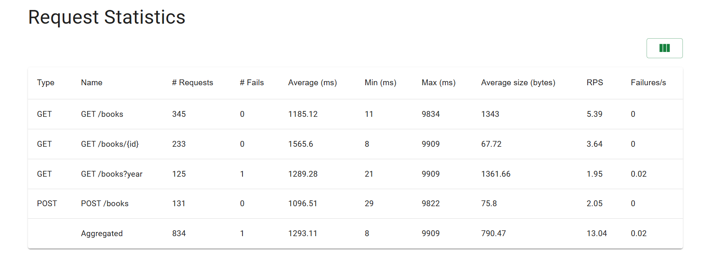
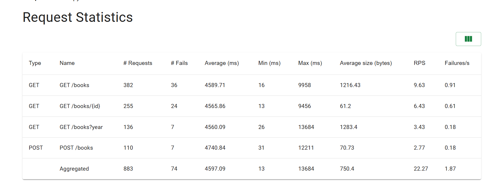
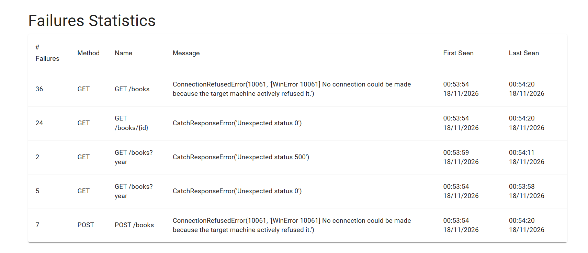

# Lab 4 — Kiểm thử hiệu năng Books API bằng Locust


Xây dựng workload cho Books API, bổ sung task `search_by_year(year)` có xác suất 1% giả lập HTTP 500, chạy ba kịch bản A/B/C và phân tích kết quả theo đề.

| Yêu cầu | File thực hiện |
|---|---|
| Locustfile và task tìm theo năm | [performance/locustfile.py](performance/locustfile.py) |
| Báo cáo baseline A | [reports/A.html](reports/A.html) |
| Báo cáo load test B | [reports/B.html](reports/B.html) |
| Báo cáo spike test C | [reports/C.html](reports/C.html) |
| Ba câu phân tích và bonus | [performance/analysis.md](performance/analysis.md) |

README trình bày cách thực hiện, số liệu và minh chứng. `analysis.md` là file phân tích riêng theo yêu cầu bài nộp.


```powershell
# Chỉ tạo nếu chưa có môi trường tại SOA

& "..\..\.venv\Scripts\python.exe" -m pytest -q
```

Kết quả bộ test API đã ghi nhận: **7 passed**. Đây là kiểm thử chức năng, không thay thế kiểm thử tải.


## 3. Bước 1 — Workload và task search_by_year

| Task | Request | Trọng số |
|---|---|---:|
| `list_books` | `GET /books` | 3 |
| `read_book` | `GET /books/{id}` | 2 |
| `create_book` | `POST /books` | 1 |
| `search_by_year(year)` | `GET /books?year=...` | 1 |

Mỗi virtual user nghỉ ngẫu nhiên 1–3 giây giữa các task. Task tìm theo năm sử dụng năm truyền vào; nếu không truyền, chọn ngẫu nhiên trong `1996`, `2017`, `2021`.

Mỗi request tìm theo năm có xác suất 1% gửi header `X-Lab-Simulate-500: 1`. Khi bật cấu hình `LAB_FAULT_INJECTION`, API trả **HTTP 500 thật**, JSON có `code = SIMULATED_ERROR`; Locust ghi nhận failure. Cấu hình giả lập mặc định tắt và chỉ tác động request tìm kiếm có tham số `year`.

1% là xác suất trên request tìm theo năm, không phải tỷ lệ cố định của toàn workload. Tỷ lệ quan sát có thể khác 1%, hoặc bằng 0 nếu mẫu nhỏ. Task đọc ID chấp nhận HTTP 200/404 có chủ đích; lỗi kết nối và status khác vẫn được tính failure.




## 4. Bước 2 — Ba kịch bản chạy

| Kịch bản | Mục đích | Users | Spawn/s | Thời gian |
|---|---|---:|---:|---:|
| A | Baseline, tải nhẹ | 10 | 2 | 30s |
| B | Load test thông thường | 50 | 5 | 60s |
| C | Spike test | 200 | 50 | 30s |

### Chạy tự động

```powershell
& "..\..\.venv\Scripts\python.exe" performance/run_lab.py
```


Khi hoàn tất thành công, terminal hiển thị:

```text
Updated reports/A.html, B.html, C.html and performance/analysis.md
```

### Lệnh Locust 


```powershell
$env:LAB_FAULT_INJECTION = "1"
& "..\..\.venv\Scripts\python.exe" -m app --port 5000
```

Ở terminal thứ hai, vẫn tại `Lab 4`:

```powershell
New-Item -ItemType Directory -Force reports | Out-Null

# A — baseline
& "..\..\.venv\Scripts\python.exe" -m locust -f performance/locustfile.py --headless -H http://127.0.0.1:5000 -u 10 -r 2 -t 30s --html reports/A.html

# B — load test
& "..\..\.venv\Scripts\python.exe" -m locust -f performance/locustfile.py --headless -H http://127.0.0.1:5000 -u 50 -r 5 -t 60s --html reports/B.html

# C — spike test
& "..\..\.venv\Scripts\python.exe" -m locust -f performance/locustfile.py --headless -H http://127.0.0.1:5000 -u 200 -r 50 -t 30s --html reports/C.html
```


| Kịch bản | Tổng request | Failures | p95 (ms) | Failure rate | RPS |
|---|---:|---:|---:|---:|---:|
| A | 137 | 0 | 170 | 0,00% | 4,24 |
| B | 834 | 1 | 6.200 | 0,12% | 13,04 |
| C | 883 | 74 | 8.300 | 8,38% | 22,27 |

Ảnh cần chụp bảng Statistics/percentiles của đúng HTML tương ứng, thấy rõ Aggregated và p95.







## 6. Bước 3 — Phân tích

### Câu 1. Trong ba kịch bản, kịch bản nào có p95 cao nhất? Vì sao?

**C có p95 cao nhất: 8.300 ms**, tiếp theo B: 6.200 ms và A: 170 ms. Tăng tải có thể làm tăng thời gian chờ CPU, thread, kết nối và tranh chấp ghi SQLite. Throughput tăng nhưng độ trễ cũng tăng mạnh, cho thấy khả năng đáp ứng suy giảm trong môi trường đo.

Đây là các nguyên nhân dự đoán dựa trên code và môi trường; chưa có profiling để xác định nút thắt thực tế. Ba kịch bản khác cả thời lượng và spawn rate, nên chưa thể suy ra quy luật tăng chỉ theo số user.

### Câu 2. Có endpoint nào fail rate tăng theo số user? Đoán nguyên nhân dựa trên code.

| Endpoint | A: failures/requests | B: failures/requests | C: failures/requests |
|---|---:|---:|---:|
| `GET /books` | 0/55 (0,00%) | 0/345 (0,00%) | 36/382 (9,42%) |
| `GET /books/{id}` | 0/37 (0,00%) | 0/233 (0,00%) | 24/255 (9,41%) |
| `GET /books?year` | 0/14 (0,00%) | 1/125 (0,80%) | 7/136 (5,15%) |
| `POST /books` | 0/31 (0,00%) | 0/131 (0,00%) | 7/110 (6,36%) |

Trong các lần chạy này, cả bốn endpoint đều có fail rate cao hơn ở C. B có 1 lỗi HTTP 500 ở tìm theo năm. C gồm 2 lỗi HTTP 500 ở tìm theo năm và **72 lỗi kết nối**: 36 list, 24 đọc ID, 5 tìm theo năm, 7 tạo sách.

Hai lỗi 500 phù hợp cơ chế giả lập. `ConnectionRefusedError(10061)` và status 0 cho biết request không nhận được HTTP response, không phải lỗi 500 giả lập. Có thể server hoặc hệ điều hành không tiếp nhận kết nối tại thời điểm đó; cần đối chiếu log và trạng thái tiến trình để xác định nguyên nhân. Không đủ bằng chứng khẳng định server quá tải hay dừng. Xác suất giả lập 1% không tăng theo số user.



### Câu 3. Nếu production cần SLO p95 < 300 ms, kịch bản nào đạt? Đề xuất baseline cho CI gate.

**Chỉ A đạt SLO p95 tổng < 300 ms**; B và C không đạt. Nếu SLO áp cho từng endpoint, cần kiểm tra p95 riêng thay vì chỉ dựa trên Aggregated.

Đề xuất A làm baseline CI ban đầu: 10 users, spawn 2/s, 30 giây, database sạch 50 sách và runner cố định. Gate đề xuất: p95 tổng < 300 ms và không có lỗi ngoài lỗi giả lập. Chạy riêng lượt tắt fault injection để kiểm tra 0 lỗi; lượt bật injection kiểm tra khả năng ghi nhận lỗi. Không ép tỷ lệ lỗi bằng đúng 1% với mẫu nhỏ. Lặp baseline vài lần và tăng thời gian đo nếu mẫu ít trước khi cố định ngưỡng; B/C dùng kiểm tra tải định kỳ.

## 7. Bonus — Nếu connection pool giới hạn 5 thì sao với 200 user?

Khi cả 5 connection đều bận, request cần connection thứ sáu phải chờ. p95 có thể tăng, throughput chững lại và có thể phát sinh pool timeout. 200 virtual user không đồng nghĩa 200 truy vấn đồng thời vì mỗi user còn nghỉ giữa các task.

Để kiểm chứng, cấu hình `QueuePool` với `pool_size=5`, `max_overflow=0`, `pool_timeout` cố định, rồi chạy C. Đối chứng với pool lớn hơn trên cùng dữ liệu, server và workload. So sánh p95, RPS, failures trong Locust; đồng thời đối chiếu log pool timeout, thời gian chờ checkout và số connection đang dùng phía server.

Chỉ đặt `pool_size=5` chưa giới hạn cứng nếu còn overflow. Code hiện tại chưa thực hiện thí nghiệm pool 5; đây là câu trả lời lý thuyết và phương pháp kiểm chứng, không phải kết quả đã đo. SQLite cũng có giới hạn ghi riêng.

## 8. Ảnh minh chứng và ghi chú kết quả

Các đường dẫn `reports/evidence/*.png` là đường dẫn tạm. Sau khi chụp, đặt ảnh theo đúng tên hoặc sửa liên kết. Ảnh phải khớp số liệu của HTML đang nộp. Nếu chạy lại, cập nhật bảng README theo báo cáo mới vì script chỉ tự cập nhật `analysis.md`.

Lần chạy tạo các HTML hiện tại đã kết thúc phần đo nhưng lỗi khóa `C.db` khi dọn thư mục tạm, trước bước tự cập nhật phân tích. `analysis.md` đã được tạo lại từ đủ ba HTML này. Script đã sửa phần dừng cây tiến trình server trên Windows và xử lý dọn tạm; bản sửa đó chưa được xác minh bằng một lượt A/B/C mới.
