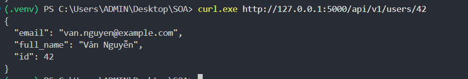
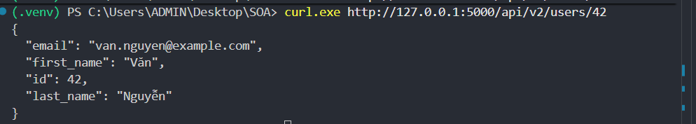

# Lab 1 - URI Path Versioning voi Flask Blueprint


- `/api/v1/users/<id>` tra ve `full_name`
- `/api/v2/users/<id>` tra ve `first_name` va `last_name`


## Kiem tra

```powershell
curl.exe http://127.0.0.1:5000/api/v1/users/42
curl.exe http://127.0.0.1:5000/api/v2/users/42
```



