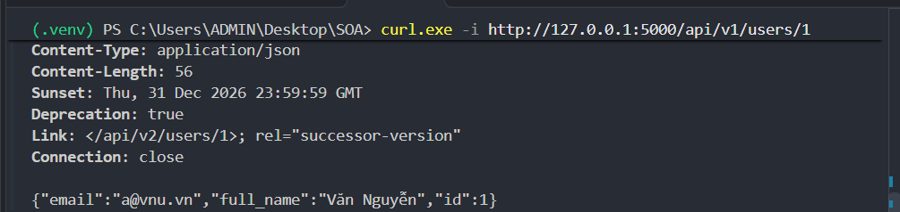
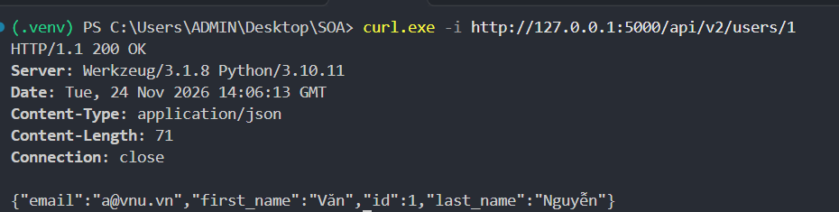
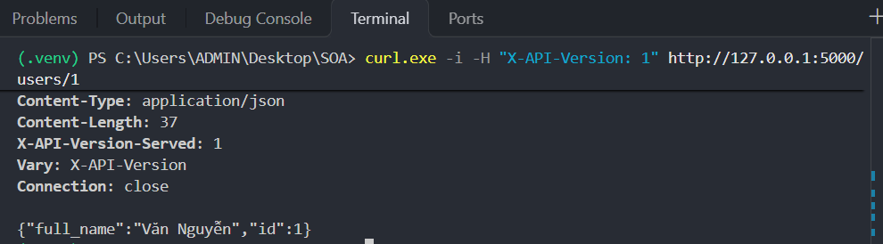
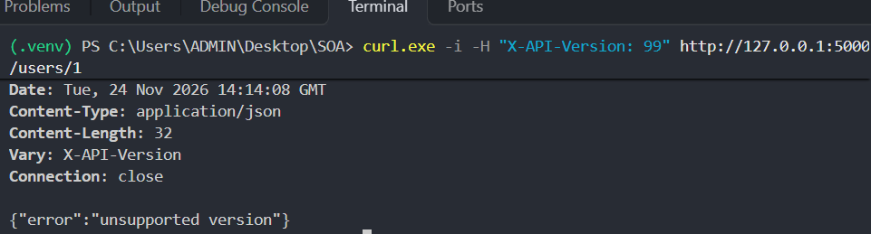
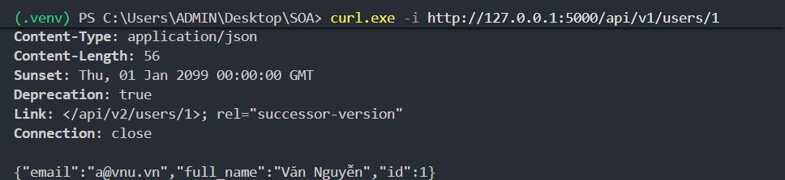
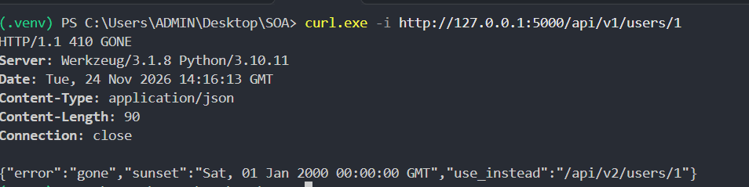
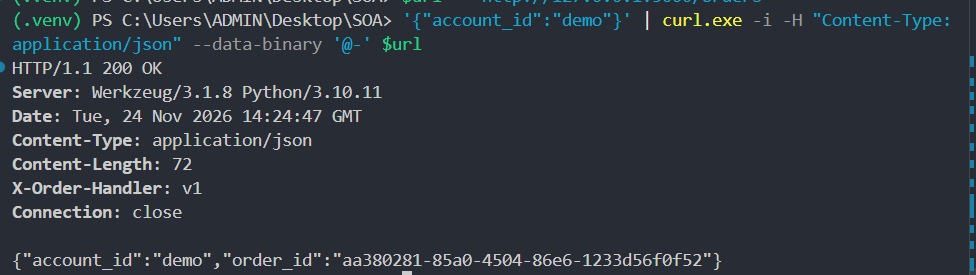
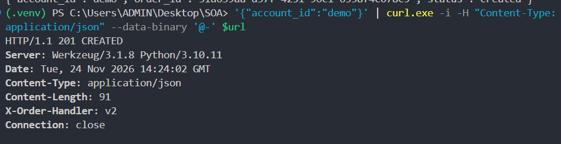

# Tuần 12 · API Versioning


python -m flask --app app run


```powershell
curl.exe -i http://127.0.0.1:5000/api/v1/users/1
curl.exe -i http://127.0.0.1:5000/api/v2/users/1
curl.exe -i http://127.0.0.1:5000/api/v2/users/999
```


### Minh chứng





## Practice 2 · Header Versioning

Decorator `@api_version` đọc `X-API-Version` để chọn schema trên cùng URL `GET /users/1`. Response của phiên bản được hỗ trợ có `X-API-Version-Served`.

### Kiểm tra


```powershell
curl.exe -i http://127.0.0.1:5000/users/1
curl.exe -i -H "X-API-Version: 1" http://127.0.0.1:5000/users/1
curl.exe -i -H "X-API-Version: 2024-06-20" http://127.0.0.1:5000/users/1
curl.exe -i -H "X-API-Version: 99" http://127.0.0.1:5000/users/1
```






## Practice 3 · Sunset Middleware

Decorator `@deprecate_at` áp dụng cho `GET /api/v1/users/1`. Mốc mặc định là **31/12/2026 lúc 23:59:59 UTC**.

### Trước sunset


```powershell
$env:V1_SUNSET = '2099-01-01T00:00:00+00:00'
python -m flask --app app run
```

Gửi request từ terminal thứ hai.

```powershell
curl.exe -i http://127.0.0.1:5000/api/v1/users/1
```




### Sau sunset

Dừng Flask bằng Ctrl+C rồi chạy lại với mốc quá khứ.

```powershell
$env:V1_SUNSET = '2000-01-01T00:00:00+00:00'
python -m flask --app app run
```



## Practice 4 · Blue-Green Routing


### Kiểm tra ở mức 5%

Đặt `$env:V2_PERCENT = '5'` 

```powershell
$url = 'http://127.0.0.1:5000/orders'
'{"account_id":"demo"}' | curl.exe -i -H "Content-Type: application/json" -H "X-Cohort: beta" --data-binary '@-' $url
```


### Kiểm tra ở mức 100%

đặt `$env:V2_PERCENT = '100'` 





