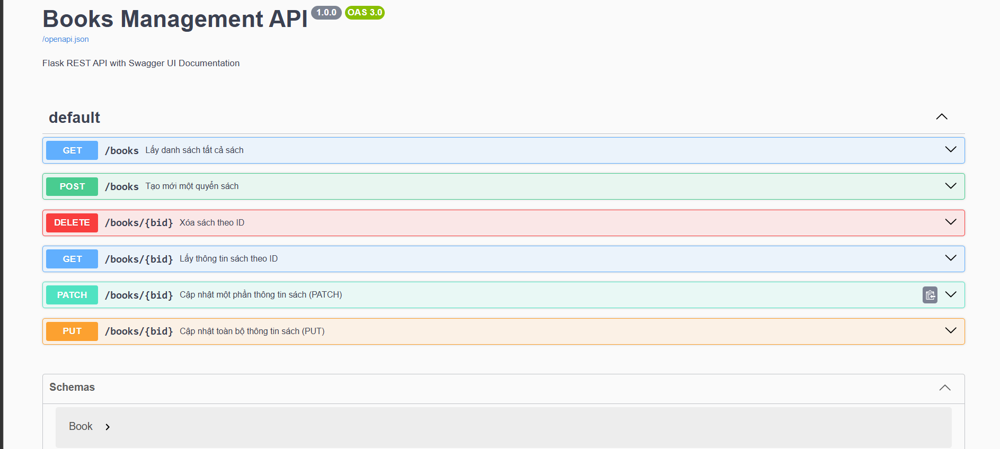

```markdown
# Flask Books Management API

Ứng dụng Flask REST API quản lý danh sách sách, tích hợp tài liệu tương tác Swagger UI theo chuẩn OpenAPI 3.0.

---

## 1. Tính năng chính

- **`GET /books`**: Truy xuất toàn bộ danh sách sách hiện có kèm tổng số lượng.
- **`POST /books`**: Tạo mới một ấn phẩm với các trường `title` và `author`.
- **`GET /books/<id>`**: Truy xuất thông tin chi tiết theo ID (hỗ trợ cơ chế cache).
- **`PUT /books/<id>`**: Ghi đè toàn bộ thông tin của sách.
- **`PATCH /books/<id>`**: Cập nhật linh hoạt các trường `title` hoặc `author`.
- **`DELETE /books/<id>`**: Xóa ấn phẩm theo ID.
- **`GET /docs`**: Cung cấp giao diện Swagger UI để tương tác trực tiếp trên trình duyệt.

---

## 2. Cài đặt và Triển khai

### 2.1. Yêu cầu hệ thống
- Python 3.8 trở lên
- Thư viện Flask

### 2.2. Các bước thiết lập
1. Cài đặt thư viện phụ thuộc:
   ```bash
   pip install flask
   ```

2. Khởi chạy ứng dụng:
   ```bash
   python app.py
   ```
   Ứng dụng khởi động tại địa chỉ: `[http://127.0.0.1:5000](http://127.0.0.1:5000)`

---

## 3. Tài liệu API (Swagger UI)

Truy cập giao diện Swagger UI tại đường dẫn:
`[http://127.0.0.1:5000/docs](http://127.0.0.1:5000/docs)`

Giao diện cho phép kiểm thử trực tiếp các endpoint thông qua tính năng "Try it out".



---

## 4. Đặc tả OpenAPI

Đặc tả OpenAPI JSON được cấu hình sẵn tại endpoint:
`[http://127.0.0.1:5000/openapi.json](http://127.0.0.1:5000/openapi.json)`
```